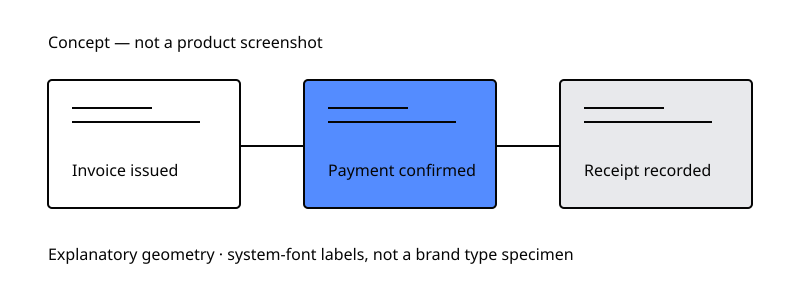

# Stenmont
## Brand book · 6 November 2026

**Commerce infrastructure with the clarity of a well-kept record.** This is a strategy statement, not an approved tagline.

The identity combines the founder's custom lowercase wordmark with Neue Haas Grotesk, a White/Ink foundation and restrained Cornflower emphasis. It serves businesses and developers through readable information and explicit evidence. The current app remains on legacy Whitechain colours.

## 01 · Strategy

[BRAND-STRATEGY.md](BRAND-STRATEGY.md) defines the offer, audience and proof standards. The system's visual construction is an aligned record column and event rail, drawn from invoice, payment and record behavior. No claim of institutional adoption, certification, mainnet availability or legal clearance is made.

## 02 · Identity

[LOGO.md](LOGO.md) preserves the custom lowercase wordmark. Its actual vector master and approved variants are missing from the permitted inventory. No substitute mark is supplied. Clear space and minimum size are provisional until the artwork can be tested.

[TYPOGRAPHY.md](TYPOGRAPHY.md) specifies Neue Haas Grotesk Display Medium and Text Regular/Medium. The app references an Adobe project; entitlement, domains and exact weights remain to be verified. No fonts are distributed.

## 03 · Colour

[COLORS.md](COLORS.md) defines Paper White #FFFFFF, Ink #050505, Cornflower #548CFF and Neutral Grey #E8E9EC, functional status roles, measured contrast and the legacy migration table. Use Ink labels on Cornflower. Restrict blue to emphasis and interaction rather than filling every component.

## 04 · Structure

[SPACING-AND-LAYOUT.md](SPACING-AND-LAYOUT.md) specifies a 4 px spacing base, responsive 4/8/12-column grids and purpose-specific containers. [VISUAL-LANGUAGE.md](VISUAL-LANGUAGE.md) defines original explanatory geometry. [ICONOGRAPHY.md](ICONOGRAPHY.md) defines one consistent outline style.

This diagram is conceptual, not a product screenshot or live acceptance evidence.

## 05 · Product communication

[VOICE-AND-TONE.md](VOICE-AND-TONE.md) names the action and consequence. [MESSAGING.md](MESSAGING.md) separates working taglines from approved claims. Explain business outcomes first, technical evidence where needed. Never turn a pending payment into a visual success.

## 06 · Interaction

[UI-DESIGN-SYSTEM.md](UI-DESIGN-SYSTEM.md) defines controls, tables, navigation and states. [ACCESSIBILITY.md](ACCESSIBILITY.md) records contrast and interaction checks. [MOTION.md](MOTION.md) keeps transitions functional and reduced-motion aware. These are specifications, not changes already shipped in the app.

## 07 · Applications

[BRAND-APPLICATIONS.md](BRAND-APPLICATIONS.md) covers marketing, dashboard, checkout, developer portal, API reference, tables, confirmations, presentations, social and transactional documents. Operational screens prioritize task completion; documentation prioritizes exact interfaces; marketing gives one clear explanation and evidence.

## 08 · Asset and approval register

| Status | Deliverable |
|---|---|
| Founder approved | Logo direction, supporting typeface, four-colour core palette |
| Proposed specification | Layout, controls, motion, status colours, icon construction and record geometry |
| Supplied original vectors | Functional icon sprite, record-grid pattern, conceptual payment-record diagram |
| Required future assets | Custom logo master and variants, approved favicon |
| Required verification | Font entitlement/domains/weights; logo small-size reproduction; app accessibility after migration |
| Deferred implementation | App theme migration, production deployment, unbuilt product claims |

Use [README.md](README.md) as the handoff index and [PROMPT.md](PROMPT.md) for future vector briefs. Preserve protected reference folders and never commit trial font files. App migration needs a separate reviewed change; this manual cannot authorize it.
