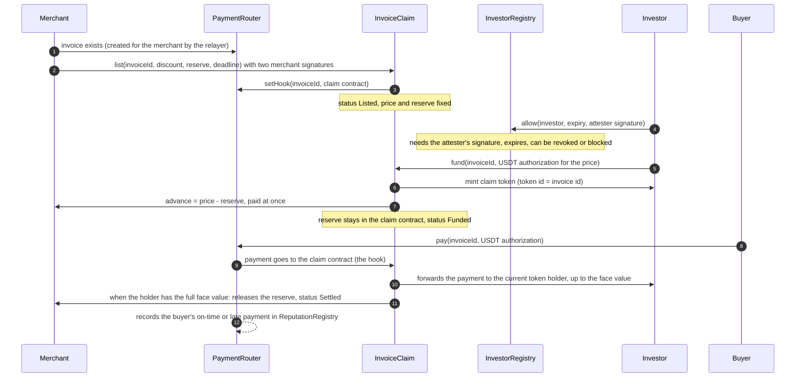

# Invoice financing: the lifecycle, step by step

A business sells an unpaid invoice to an investor for cash today. When the customer pays the invoice, the contract pays the investor and settles the deal. The contracts decide who gets what, not a paper agreement. Everything below is read from the contracts in `contracts/src/` (`InvoiceClaim.sol`, `InvestorRegistry.sol`, `ReputationRegistry.sol`, `PaymentRouter.sol`).

## Who does what

| Party | Role |
|---|---|
| Merchant (supplier) | Owns the invoice. Signs the offer. Receives cash today. |
| Investor | Buys the claim at a discount. Holds an ERC-721 token whose id is the invoice id. |
| Buyer (customer) | Pays the invoice as normal. Does not need to know it was sold. |
| Attester | Signs the investor's allowlist entry after the off-chain World check. |
| Relayer | Sends the transactions and pays the gas. It cannot move anyone's money without their signature. |

## The sequence

If the customer does not pay, the last steps change: seven days after the due date anyone may call `markDefault`, the reserve goes to the investor, and the status becomes Defaulted.

## The numbers

For an invoice of face value `F`, a discount `d` and a reserve `r` (both in basis points):

- Price the investor pays: `F x (10000 - d) / 10000`
- Reserve: `F x r / 10000`
- Cash the merchant receives today (the advance): `price - reserve`
- If the customer pays: the investor receives `F` in total (profit = `F - price`), and the merchant gets the reserve back, so the merchant receives `price` in total.
- If the customer never pays: the investor keeps the reserve as first-loss cover, and the merchant keeps the advance.

Both divisions round down. Example: a 100 USDT invoice at 5% discount and 10% reserve costs the investor 95, gives the merchant 85 today, and holds 10 back.

Limits: the contract requires the discount below 100% and discount plus reserve at most 100%. The API is stricter: discount up to 30%, reserve up to 50%.

## What the contracts enforce on chain

**Listing (`InvoiceClaim.list`)**
- The invoice must be open, have no payment on it, have no payout hook yet, and have a due date in the future.
- The merchant must sign the claim terms and the router's `SetHook`. A relayer cannot list on the merchant's behalf without both signatures.
- The price must not be zero. The listing expires at the earlier of the signed deadline and the due date (`fundBy`).
- An unfunded listing can be withdrawn only with the merchant's signed `CancelInvoice` (`cancelListing`), and a funded claim cannot be cancelled. The router refuses a merchant cancelling a hooked invoice directly.

**Investor allowlist (`InvestorRegistry`)**
- An entry exists only with the attester's EIP-712 signature (`AllowInvestor`), which has a per-investor nonce and a deadline, so it works once.
- Every entry has an expiry. The owner can revoke an entry or block an account for good; a blocked account cannot be allowed again.
- `fund` requires the investor to be allowed at that moment.

**Funding (`InvoiceClaim.fund`)**
- The listing must still be open (not past `fundBy`), and the invoice must still be open on the router.
- The investor's USDT authorization uses a nonce derived from the invoice id and a salt (`fundNonce`), so a signed funding cannot be redirected to another invoice.
- The token is minted to the investor, the merchant's payout address receives the advance, and the reserve stays in the claim contract.

**Transfer restriction (`_update`)**
- After the mint, the token can move only while the contract is not paused, the claim is Funded or Defaulted, and both the sender and the receiver are currently allowlisted.
- So a holder who has been revoked cannot sell to anyone, and nobody can send the claim to an unverified account.

**Frozen after settlement**
- Once a claim is Settled the token cannot be transferred at all.

**Payments (`onPaid`, called only by the router)**
- Payments go to the current holder until the holder has received the face value. Any amount beyond that goes to the merchant.
- When the holder has received the full face value, the status becomes Settled and the reserve is released to the merchant.
- A payment that arrives while the claim is only Listed cancels the claim and goes to the merchant, because nothing was sold.
- If a payout is refused by the token (for example a blocked recipient), the customer's payment still succeeds and the amount is credited to `pending`, which the recipient collects with `withdrawPending`.
- Nothing stays in the claim contract after a call except unreleased reserve and `pending` amounts.

**Default after the grace period (`markDefault`)**
- Anyone may call it once more than seven days (`GRACE`) have passed after the due date and the claim is still Funded.
- The reserve goes to the holder, but never more than what is still owed, and the rest of the reserve (if any) goes to the merchant.
- It can run once. A payment that arrives after a default still pays the holder up to the face value, and the rest goes to the merchant.

**Reputation (`ReputationRegistry`)**
- The router records each fully paid invoice for the buyer (on time or late, and volume) through a call that cannot block a payment. The public score is the share of paid invoices that were on time.

**Pause**
- The guardian or owner can pause listing, funding, defaulting and transfers of the claim contract. Pausing it does not stop `onPaid`; the router has its own pause for payments.

## Where you can watch it

- **Merchant dashboard, Financing** (`/dashboard/financing`): each financed invoice with the steps Listed, Investor verified, Funded, Customer pays, Settled or Defaulted, the amounts, the times, and an explorer link for each transaction. The merchant can choose whether the public certificate shows the invoice number (hidden by default).
- **Public certificate** (`/claim/<invoiceId>`, no login): face value, discount, due date, status, the holder as a short address, the token id, the contract, explorer links, and the buyer's payment record. The status is read from the database and confirmed against the chain; if they disagree, or the chain cannot be read, the page says "Unconfirmed". It never shows customer emails, names or invoice metadata.
- **Investor market** (`/invest`) and **claim page** (`/invest/<invoiceId>`): what can be bought now.
- **Script** (`pnpm --filter @stenmont/scripts tokenization-lifecycle -- --dry-run`): runs the whole lifecycle on the staging chain with the test wallets and prints every explorer link.

## Limits

- The script's allowlist step uses the attester key directly and skips the World proof. The real flow (`POST /invest/allow`) verifies a World proof first. The script prints a warning when it does this.
- The script drives the contracts directly, so the API database has no record of its claims. The dashboard timeline and the public certificate only show claims listed through a merchant account (Sell this invoice in the dashboard).
- The default path cannot be run live in one sitting because of the seven-day grace. It is covered by unit tests (`test_markDefault_*` in `contracts/test/InvoiceClaim.t.sol`) and a fork test against the real USDT: `cd contracts && forge test --profile fork --match-test test_fork_defaultPaysReserveToInvestor -vv`.
- The merchant's timeline times are when our database recorded each step (within about a minute of the block), not block timestamps.
- This is a test network. Legal review is needed before real investors.
