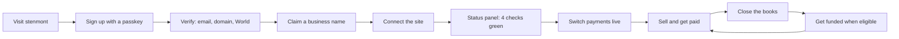
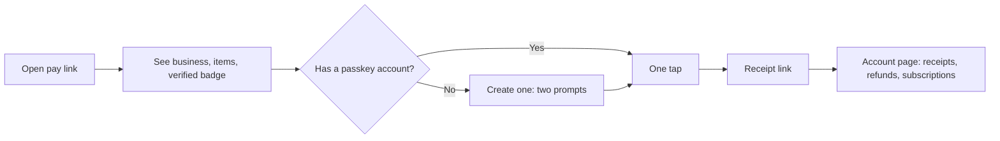

# Stenmont: user flows

Stenmont is a commerce and finance platform for businesses that run on stablecoins: **sell, get paid, close the books, get funded**. The category is **The agentic business kit**. A financial agent can install checkout through Connect and help operate the business within explicit permissions. The merchant uses one dashboard; payers bring their own USDT.

Status legend: ✅ recorded live proof on staging/testnet, 🟡 implemented or partially proven with the stated acceptance still open, ⛔ unavailable in the deployed build. A green mark applies only to the evidence described, not every variation of the flow.

## Who is who

| Role | Who | What they need to know about crypto |
|---|---|---|
| Merchant | A business, creator or developer who earns USDT | Nothing. A passkey account is created for them |
| Payer | Anyone who already holds USDT, a person or a company with a large order | Where their USDT is. They pay with one tap |
| Investor | Buys discounted receivables | Must meet the configured eligibility rules; real World/dashboard acceptance remains open |
| Agent | Software acting for a merchant or a payer | Uses scoped access; spending rules are contract-enforced where implemented, while draft and collections policy checks are API-enforced |
| Accountant | The merchant's bookkeeper | Nothing. Receives a CSV |

## 1. Set up the business and install the kit



| Step | What happens | Status |
|---|---|---|
| Sign up | Passkey, no password. A smart account for the business is created and activated | ✅ |
| Bot defence and email | Turnstile on sign-up; email one-time code; verified email | 🟡 |
| Verification tiers | T0 passkey, T1 email, T2 domain, T3 World Proof of Human, T4 documents (sandbox provider only) | 🟡 |
| Claim a name | `label.stenmont.eth` on Ethereum Sepolia, with team roles limited to chosen records and an optional permanent payout lock | ✅ |
| Connect: by prompt | The dashboard gives a copy-paste prompt per platform (Next.js, plain HTML, Shopify theme, WooCommerce, Webflow). The merchant's own AI agent installs the checkout | ✅ one isolated store |
| Connect: by OAuth | The agent connects to the Stenmont MCP server through OAuth 2.1 with PKCE, scoped read, draft or write, revocable | ✅ real MCP inspector |
| Connect: developer | Docs, `llms.txt`, SDK, webhooks with signature verification | ✅ |
| Status panel | Checks: site reachable, DNS TXT domain proof, signed test webhook, test payment. A live or paused switch | ✅ 4 of 4 on the isolated demo shop, including DNS and payment |
| API keys | Restricted keys, shown once, revocable | ✅ |

## 2. Migrating from Shopify

| Step | What happens | Status |
|---|---|---|
| One-click | Merchant enters the store name, lands on Shopify's own consent page, clicks Install once | 🟡 needs a Shopify app (client id and secret) |
| CSV | Merchant uploads Shopify's own product export | 🟡 |
| Admin token | Merchant pastes a read-only token, used once and never stored | 🟡 |
| Dry-run report | Counts, warnings and what cannot migrate (themes, discounts, gift cards, passwords) before anything is written | 🟡 |
| Currency | A non-USD store needs a rate the merchant enters; we never invent one | 🟡 |
| Re-import | Idempotent: updates, never duplicates, never deletes | 🟡 |

## 3. Sell: products, services and repeat business

| Way | How | Status |
|---|---|---|
| Plug into your own site | The installed checkout redirects to the Stenmont pay page; the order turns paid from a signed webhook | ✅ |
| Payment links and invoices | Due dates, partial payments, reminders | ✅ |
| Hosted store | Catalogue, public store pages, cart, server-priced checkout | 🟡 deployed; do not infer every cart/order variation from the separate demo-shop proof |
| Subscriptions | Customer signs once, capped charges, cancel any time | ✅ |

## 4. Get paid: the payer journey



| Step | What happens | Status |
|---|---|---|
| Pay with a passkey | One tap, no wallet app, no gas. The merchant's gas tank pays | ✅ |
| Pay from an existing wallet | Optional, for payers who already hold USDT | ✅ existing funded wallet payment recorded in README; no wallet was funded for acceptance |
| Verified-business badge | Shows only proofs that hold (domain, World); never overclaims | 🟡 |
| Receipts link | A signed link after payment; no account needed | 🟡 |
| Refund | Merchant signs; partial refunds allowed. Above-limit World approval is a separate gate | ✅ ordinary refund; real World approval remains pending |
| Where to get USDT | Help panel: WhiteBIT withdrawal, Portal bridge. We do not sell USDT or take cards | 🟡 |

Payers bring their own USDT. Stenmont never funds payer wallets with its own USDT.

## 5. Close the books: records that can be checked

| Step | Status |
|---|---|
| Invoices, receipts with onchain links, refunds | ✅ |
| Accountant CSV (generic and QuickBooks layout) | ✅ |
| Reminders as signed webhooks | ✅ |
| Audit log of every money action | ✅ |
| Reconciliation view, tax lines and Xero export | 🟡 implemented; not tax advice or a completed integration with accounting software |
| Signed period bundle and line proofs | ✅ real two-line interim bundle verified offline; tampered bundle rejected; not proof of complete income |
| Anchor the period root onchain | ⛔ registry deployment/configuration needs separate approval |

## 6. Get funded: optional receivable financing

```mermaid
sequenceDiagram
  participant M as Merchant
  participant I as Investor
  participant B as Buyer
  participant C as Contracts
  M->>C: List invoice (two signatures)
  I->>C: Verified and allowed
  I->>C: Fund claim at a discount (USDT)
  C-->>M: Advance paid today
  B->>C: Pays the invoice
  C-->>I: Claim repaid; claim settled
```

| Step | Status |
|---|---|
| List an invoice, fund at a discount, buyer pays, contract settles and pays the holder | ✅ real transactions on Whitechain Sepolia (see README) |
| Earlier settled run: investor paid 0.95 test USDT, received 1.00; merchant got 0.85 then 0.10; router and claim balances were zero after settlement | ✅ snapshot of that run, not a guarantee that claims never retain reserves or liabilities |
| Investor allowlist through World Proof of Human in the dashboard | 🟡 simulator only |
| Default after the 7-day grace period | 🟡 fork test, not live |
| Dashboard financing timeline and public receivable certificate | 🟡 |
| Real investors, documents-based KYC | ⛔ needs a provider account and legal review |
| Buyer acknowledgement and record-priced quotes | 🟡 source/tests exist; router v2 deployment and live acceptance remain held |

## 7. Agents

| Flow | What happens | Status |
|---|---|---|
| Merchant's agent installs the checkout | Prompt or OAuth, as in section 1 | ✅ |
| Merchant's agent reads and drafts | MCP tools: list invoices, get invoice, export payments, draft refund. A draft never moves money; a person confirms with a passkey | ✅ |
| Agent identity | An ENS agent name has published policy and expiry; scoped permissions depend on resolver support | ✅ real one-day agent name created; expiry readback not yet run |
| Agent pays an API | x402: the agent pays 0.01 USDT per call through our facilitator, inside its limits | ✅ |
| Agent finds a business by name | Reads the ENS pay directory for the named business | ✅ directory/profile records read on real Sepolia; a subsequent agent payment is a separate proof |
| Large actions | A fresh World sign-in is required | 🟡 real sign-in needs a verified person |

The in-dashboard financial agent has bounded usage, a tool allowlist and draft-only refunds. Gemini's Cloud backend is configurable; no successful live provider reply has been recorded yet. MCP installation proof does not establish a model-backed finance conversation.

## Recorded commerce proof

The separate demo shop completed a 1.00 test-USDT payment through Stenmont, received the signed webhook and showed the order as Paid; Connect reached 4/4. [Explorer transaction](https://explorer.testnet.whitechain.io/tx/0xe8c96bc95001abd0aedb148bd869d82fb32db5800496c7a3568ea4120d8c34e3). This is our isolated acceptance data, not merchant traction. Razorpay test credentials remain unset, so no Razorpay payment is claimed.

## 8. What we are honest about

- Test network, test USDT. Nothing here is real money.
- Onchain payments are public: sender, receiver, amount, time. Invoice details stay off chain.
- The sandbox KYC provider is a stand-in; a real one is not integrated.
- A lost passkey that controls the payout account cannot be recovered by email without a contract change. Email recovers dashboard access only.
- Official USDT on Whitechain mainnet is not confirmed; Whitechain's docs say it arrives later.
- No external security audit yet.
